# ai-customer-health-platform

An agentic-AI Customer Success platform: Health scoring, onboarding, adoption, expansion and renewal, planned and built with Claude Code. **It is early-stage software, built in the open.** It works end to end (import your data, score it, get reviewed recommendations, export it again) but it has not been tested at large scale. The hosted copy at [bearing360.vercel.app](https://bearing360.vercel.app) is a public demo with synthetic data only; to use it with your own real data, [run your own copy](#run-your-own-copy). Nothing here is a real company, and there is no outbound contact beyond the Anthropic API itself.

> No AI reads every account right. It gets you close enough, fast enough, to act. Across onboarding, health, expansion, and renewal.

<table>
<tr>
<td><b>Login</b> 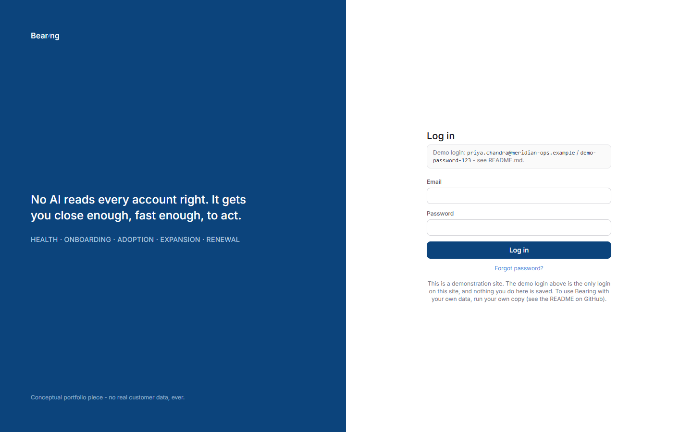</td>
<td><b>Signup</b> 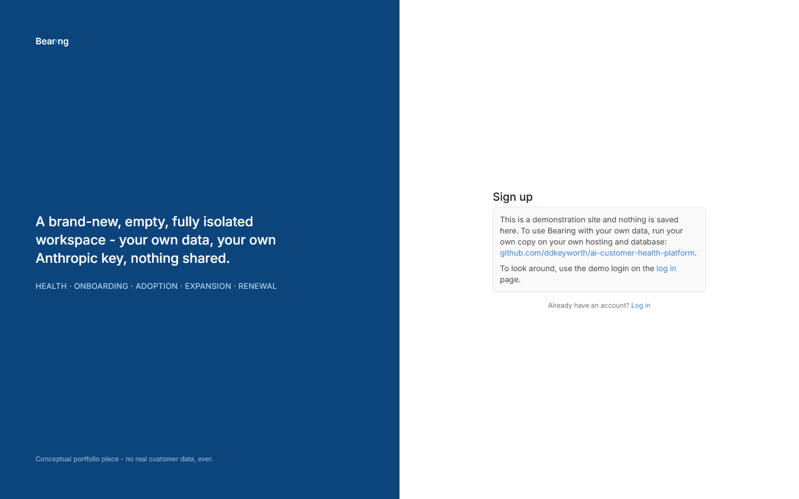</td>
</tr>
<tr>
<td><b>Home</b> 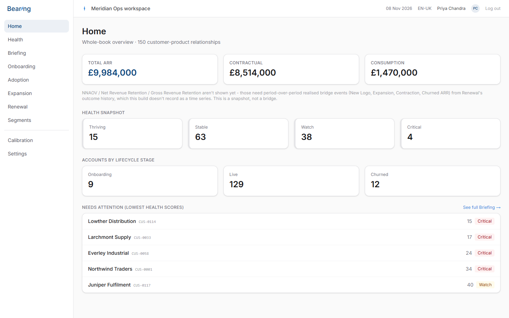</td>
<td><b>Health</b> 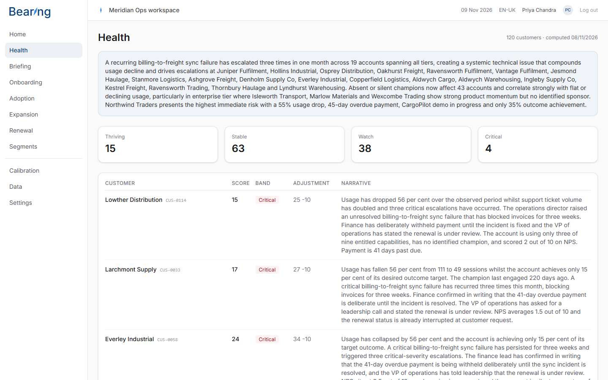</td>
</tr>
<tr>
<td><b>Health drill-in (one customer)</b> 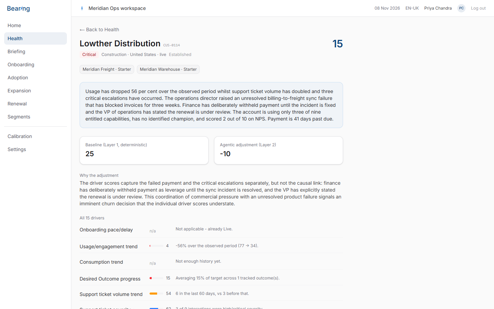</td>
<td><b>Briefing</b> 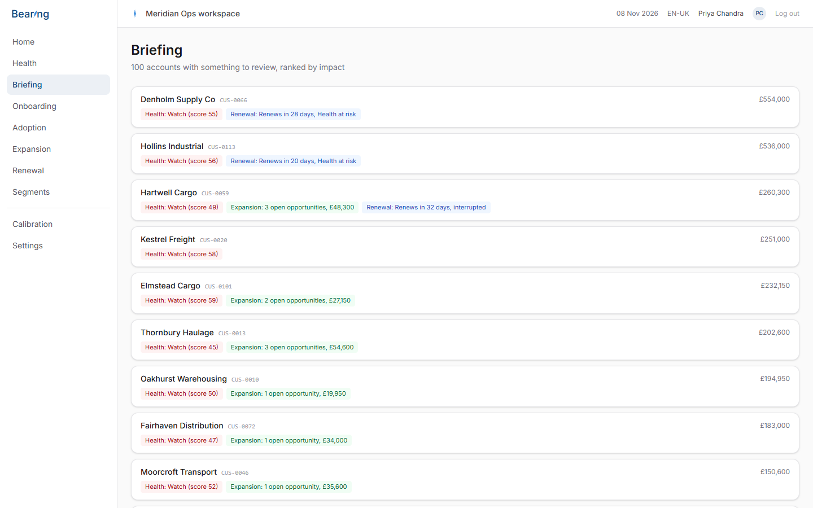</td>
</tr>
<tr>
<td><b>Onboarding</b> 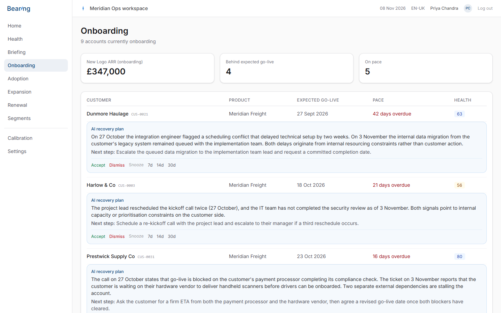</td>
<td><b>Adoption</b> 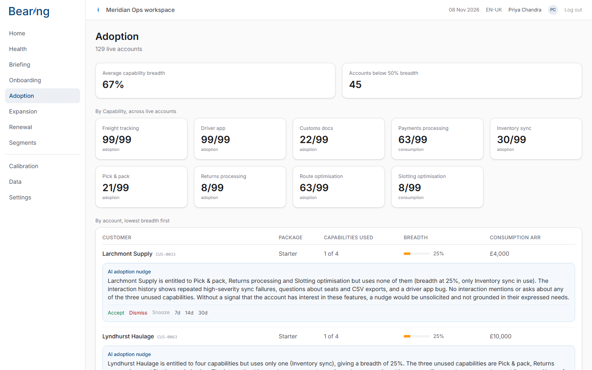</td>
</tr>
<tr>
<td><b>Expansion</b> 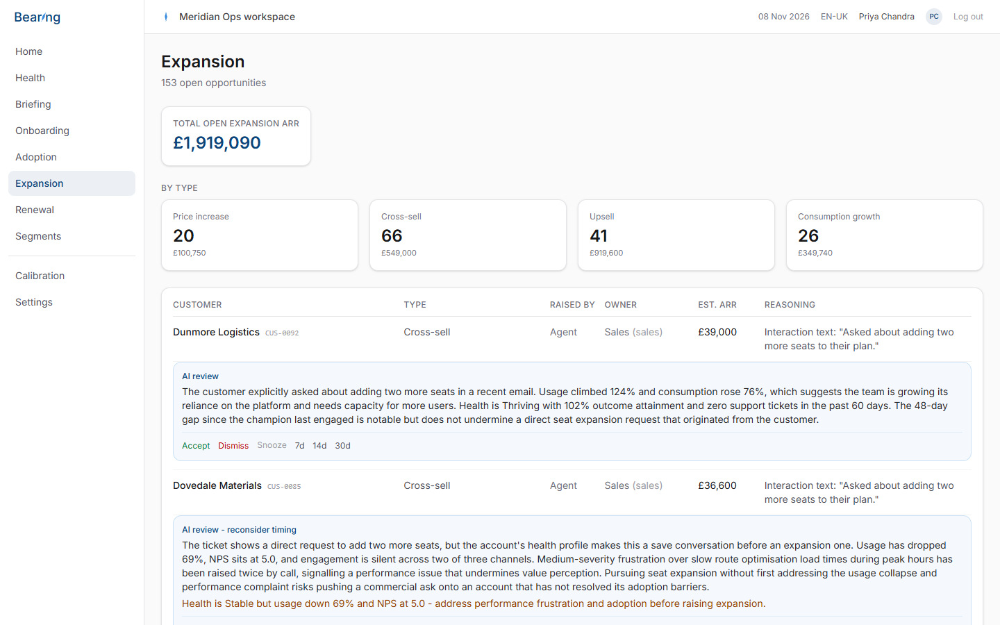</td>
<td><b>Renewal</b> (full page) </td>
</tr>
<tr>
<td><b>Segments</b> 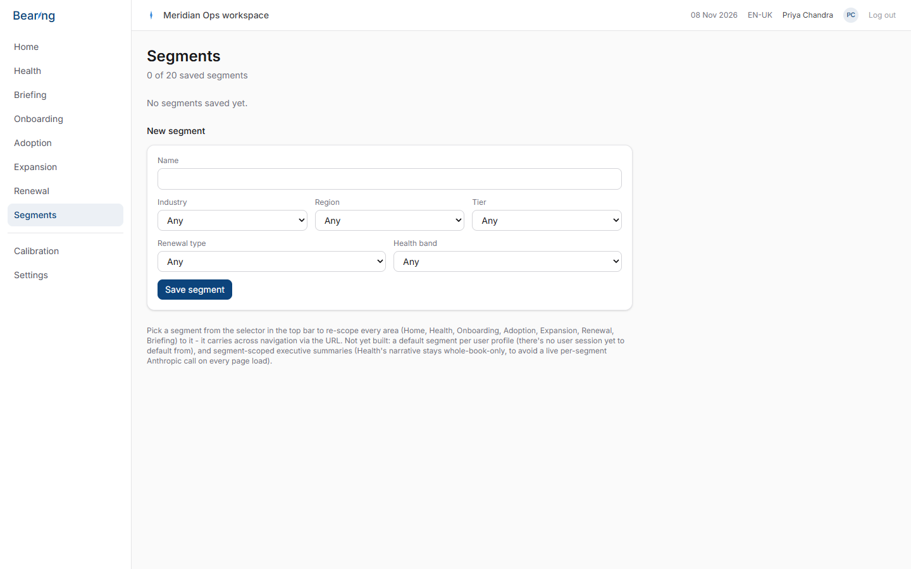</td>
<td><b>Calibration</b> 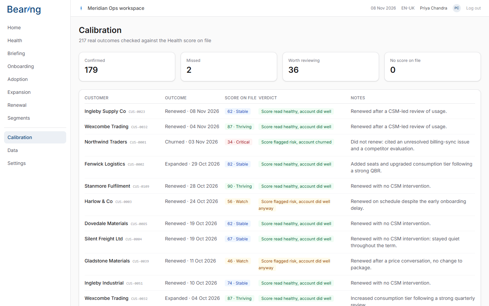</td>
</tr>
<tr>
<td><b>Settings</b> (full page) 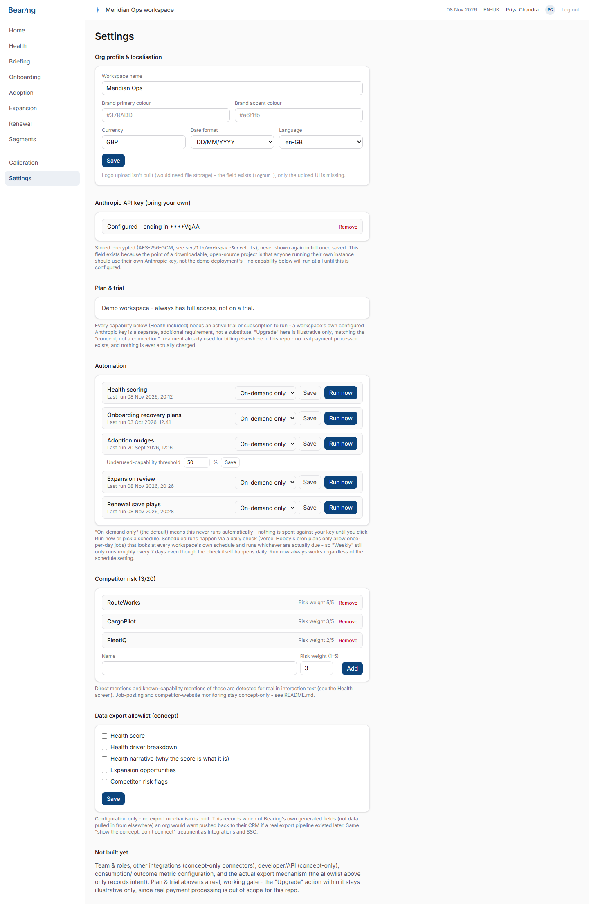</td>
<td><b>Marketing page</b> (full page) 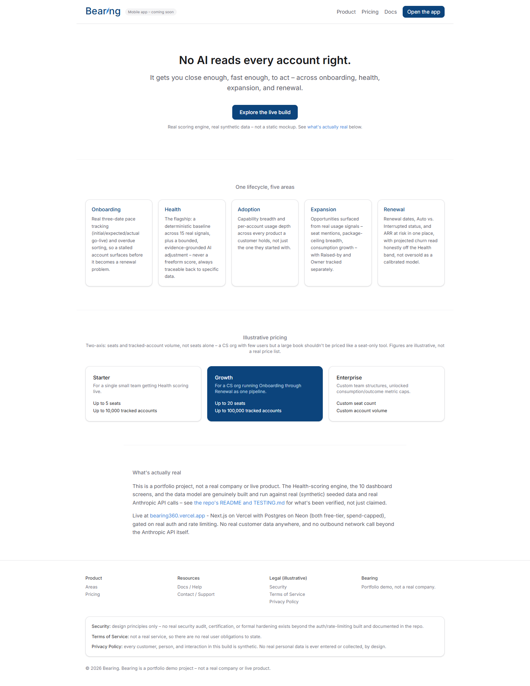</td>
</tr>
<tr>
<td><b>Data</b> (import, export, delete; full page) 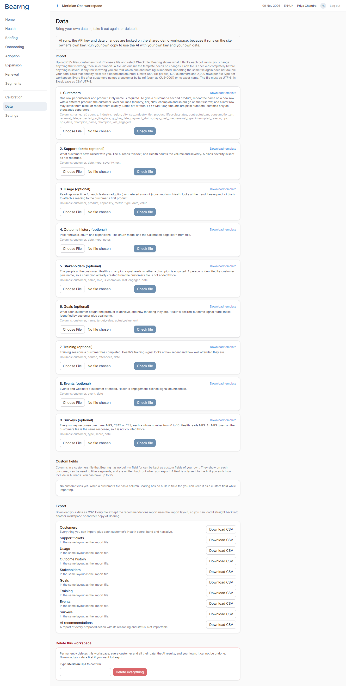</td>
<td></td>
</tr>
</table>

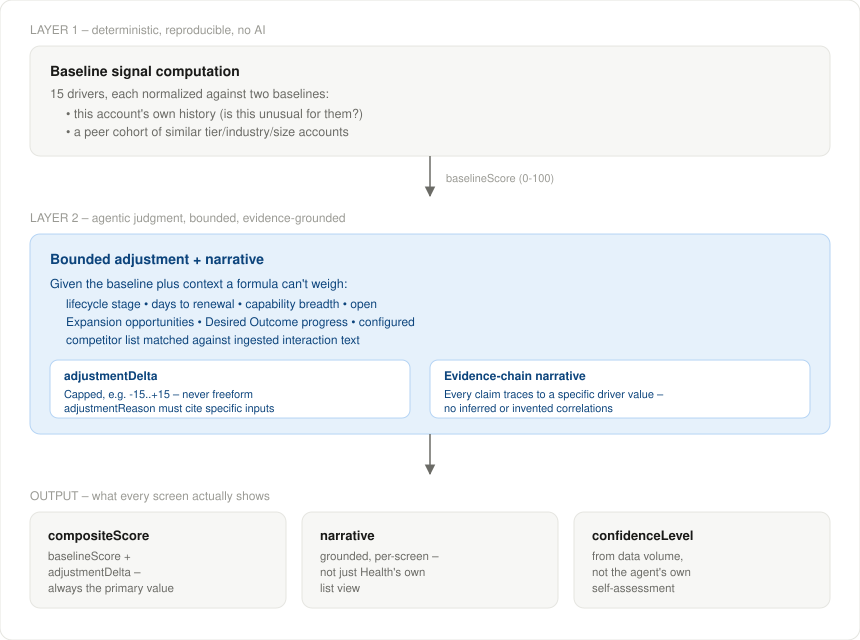

All fifteen screenshots are real captures of the live app (`/login`, `/signup`, `/`, `/health`, `/health/[customerId]`, `/briefing`, `/onboarding`, `/adoption`, `/expansion`, `/renewal`, `/segments`, `/calibration`, `/settings`, `/data`, `/marketing`), taken against the production deployment with the synthetic data described below. None are mockups. Renewal, Settings, Data and Marketing are full-page captures; the rest show the top of the page. Onboarding shows AI recovery plans on the four overdue accounts, each with Accept and Dismiss (see [Reviewing AI recommendations](#reviewing-ai-recommendations)). `health-scoring-architecture.svg` is a diagram, not a screenshot. Regenerate the screenshots with `npm run screenshots` (`scripts/capture-screenshots.mjs`, Puppeteer-driven).

The repo is named descriptively for portfolio discoverability; **"Bearing"** is the working product name used within the app and mockups themselves.

## Two ways to use it

| | **Try the demo** | **Run your own copy** |
|---|---|---|
| Where | The owner's hosted site, [bearing360.vercel.app](https://bearing360.vercel.app) | Your own hosting and your own database |
| Whose keys and costs | Nothing you do can cost the owner anything. The demo's AI results are already stored, so looking at them is free | Yours. You add your own Anthropic key and pay your own provider |
| Your data | Look around the sample data. The hosted site has no signup and saves nothing for anyone | Anything you import. It stays in your own database |
| What you can change | The demo is read-only for shared things. Accept, Dismiss and Snooze work, but only for your own visit and they disappear when you log out | Everything |
| Free trial and payment | None: nothing is hosted for you. How paid licences will work is not decided yet | No trial and no lock: set `SELF_HOSTED=true` |

The hosted site is a read-only demonstration: it has no signup and stores nobody's data. To save anything, run your own copy (below). One setting, `SELF_HOSTED`, separates the two modes. See [Your servers or the hosted site](#your-servers-or-the-hosted-site).

## What this is

Most Customer Success tooling is a system of record – a place to manage accounts, log interactions, and store contracts. This project is deliberately **not** that. It's an insight layer that sits on top of the systems that already do that job, organised around five areas of the customer lifecycle:

- **Health** – a composite score built from 15 drivers (support friction, consumption trend, capability breadth/stickiness, competitor risk, engagement silence, and more), run continuously from Onboarding through Live. The flagship area, and the one genuinely load-bearing piece of the whole idea.
- **Onboarding** – pace to first Capability go-live, with a cause-tagged log of any slippage.
- **Adoption** – usage and consumption trends per Capability, and progress against the Desired Outcomes a customer actually bought the product to achieve.
- **Expansion** – Price Increase, Cross-sell, Upsell, and Consumption Growth opportunities, each with a Raised-By and an Owner.
- **Renewal** – Auto vs. Interrupted renewals, ARR and consumption revenue at risk, and a projected-churn estimate shown honestly as an estimate, not a fact.

Every screen is meant to carry its own synthesised narrative, not just a data table – because a re-skinned CRM view isn't the point. If the reasoning underneath isn't genuinely sound, this whole idea doesn't hold up. See [Health scoring – built, and how it actually works](#health-scoring--built-and-how-it-actually-works).

## Governing principle: safe by construction, not by promise

Every design decision in this repo follows one rule: **anything that would touch the outside world, real data, or a real compliance claim is shown as a concept only – never operationalised.**

- **This repository and the maintainer's hosted demo hold only synthetic data, ever.** That is a rule about the maintainer's own deployment, not a limit on you: a copy you run on your own hosting and your own database holds whatever you choose to import, and it never leaves your database.
- No outbound network call except to the Anthropic API for the agent's own reasoning – see [Health scoring](#health-scoring--built-and-how-it-actually-works) below for what that actually does. Any other integration (a real CRM sync, a real email send, a real OAuth login, monitoring job boards or competitor websites) is represented as a UI concept, not a working connection, unless explicitly extended later with deliberate sign-off.
- No compliance claims that aren't true. No fabricated traction, testimonials, or results anywhere in this repo or its documentation.
- Every agent action is designed to be a draft a human reviews – nothing is ever sent or executed automatically.
- **No other GitHub user or self-hosted deployment can ever spend or touch the maintainer's own private API keys, database, or accounts.** Every capability that costs money (see [Automation](#automation)) requires that workspace's own configured key, with no fallback to a shared platform-wide one – enforced in code (`assertCanRun()` throws if a workspace has no key configured; the only exception is Health's free baseline, which uses no AI), not left as a documentation promise.

## What's real vs. planned

All 10 dashboard screens (Home, Health, Briefing, Onboarding, Adoption, Expansion, Renewal, Segments, Calibration, Settings) are wired to real data - nothing left as a static stub. They're not all equally deep, though - see the per-screen notes below for what's genuinely agentic vs. rule-based vs. read-only. A real public marketing page (`/marketing`) also exists, outside the dashboard shell.

**This has actually been run, not just written.** See [`TESTING.md`](TESTING.md) for the log: real Anthropic API calls against handcrafted seed customers with known-good expected behaviour, a real cross-tenant security gap found and fixed, a real bug the multi-product data exposed, and an honest account of a browser-automation false negative during testing that turned out not to be a real bug.

| Area | Status |
|---|---|
| Product definition, requirements, information architecture | Fully planned |
| Data model (Workspace, User, Customer, Product, Capability, Package, Health snapshot, Competitor config, Interaction, Usage, Survey, Event attendance, Opportunity, Segment, Desired Outcome, Stakeholder, Training completion, Outcome event, Session) | Built in `prisma/schema.prisma`, live on a real (free-tier) Postgres instance |
| App shell (navigation, layout, logo) | Built |
| Synthetic data generator (`prisma/seed.ts`) | **Built and run for real** - 120 fictional customers (each with a visible ID such as `CUS-0042`) across 2 products, in six profiles from thriving to churned. Outcome history follows tenure (an account live for 4 years has up to 4 renewals, a young one has none) and renewal dates fall on each contract anniversary, so both vary widely. Re-run it to refresh the dates around today |
| Health-scoring engine (the actual "special sauce") | **Built and tested for real** - see below. Runs against each workspace's own configured Anthropic key (see [Automation](#automation)) - on-demand, or a Daily/Weekly schedule via a real Vercel Cron job, not just a manually-run script |
| `/health` | List view, per-customer drill-in (`/health/[customerId]`), and a real LLM-generated executive summary - all reading stored data, none recomputed on page load |
| `/` (Home) | Real Total ARR, Health bands, lifecycle-stage counts, and a "needs attention" list. Deliberately does not show NNAOV/NRR/GRR - those need realised bridge events this build doesn't track yet |
| `/onboarding` | Real three-date pace tracking and overdue sorting, plus a real agentic recovery-plan layer for genuinely overdue accounts - see [Playbook agentic layers](#playbook-agentic-layers) |
| `/adoption` | Real capability breadth and per-Capability adoption stats across live accounts, plus a real agentic usage-nudge layer below a configurable breadth threshold |
| `/expansion` | Real Opportunity model (4 types), always generated by **deterministic rules** (the free, always-on baseline), with a real optional agentic review layer on top - same two-layer shape as Health |
| `/renewal` | Real renewal dates, Auto/Interrupted status, ARR at risk. Churn likelihood now comes from real recorded outcomes per Health band where there's enough history, with an illustrative per-band fallback, plus a real agentic save-play layer for at-risk accounts |
| `/segments` | Real saved filters - create/view/delete all genuinely work, capped at 20 per workspace. Picking one from the top-bar selector re-scopes every area (Home, Health, Onboarding, Adoption, Expansion, Renewal, Briefing) to it, carried via the URL - the Micro view from the original design. Health's executive summary stays whole-book-only rather than generating a live per-segment Anthropic call on every page load |
| `/settings` | Org profile/branding/localisation and competitor risk config are real, writable forms (Server Actions). A data-export allowlist config is also real (which of Bearing's own generated fields would sync to a CRM), same concept-only treatment as Integrations/SSO - no actual export mechanism exists. A workspace can also store its own Anthropic API key, encrypted at rest (see [Bring your own Anthropic API key](#bring-your-own-anthropic-api-key)), a configurable Adoption threshold, and a real run schedule for all 5 capabilities - on-demand, daily, or weekly, plus a Run now override (see [Automation](#automation)). A real free-trial/subscription gate now sits in front of every capability's AI layer - the "subscribe" action itself stays illustrative, same concept-only treatment as billing. Team & roles, other integrations, developer/API stay honest "not built yet" |
| `/briefing` | Real cross-area action queue, consolidated by account and ranked by £ impact, pulled live from Health/Onboarding/Expansion/Renewal, plus Adoption once its agentic layer has actually proposed a nudge. Briefing itself stays read-only, but Accept/Dismiss are real on each area's own page - see [Reviewing AI recommendations](#reviewing-ai-recommendations) |
| `/marketing` | Real public-facing landing page - positioning line, 5 lifecycle-area cards, illustrative two-axis pricing, and an honest "what's actually real" section. Rendered without the internal dashboard chrome via `AppShell`. Terms/Privacy/Security stay one-line honest placeholders, not real legal documents, per the governing safety principle |
| `/calibration` | Real calibration loop - every recorded `OutcomeEvent` (churned/renewed/expanded) compared against the Health score on file, classified as confirmed/missed/worth-reviewing. Not a true point-in-time backtest (one snapshot per customer, not a real historical series); nothing here adjusts driver weighting automatically - see the page's own footnote |
| `/login`, `/signup` | Real email/password authentication (bcrypt + database-backed sessions) - see [Authentication](#authentication). Signup creates a genuine new, empty, isolated workspace, not a new user in the shared demo one. It is closed on the hosted site and open only for the first account on a self-hosted copy |
| Agent core / playbooks for areas beyond Health | **Built and tested for real.** All four (Onboarding, Adoption, Expansion, Renewal) now have their own agentic layer, matching Health's two-layer depth - see [Playbook agentic layers](#playbook-agentic-layers) and [`docs/playbook-proposals.md`](docs/playbook-proposals.md) for the original design this was built from |
| Live public deployment | **Done.** [bearing360.vercel.app](https://bearing360.vercel.app) - see [Stage 2: live deployment](#stage-2-live-deployment) |
| `/data` | **Import, export and delete.** Upload customers, tickets, usage and outcome history as CSV files (all or nothing, with row-by-row error messages), download the same layouts back, and delete a workspace and all its data. See [Importing and exporting your data](#importing-and-exporting-your-data) |

### Not built yet

- **Password reset by email.** Password reset works with a recovery key instead (see [Authentication](#authentication)); an emailed link would need an email provider.
- **Adding or editing a single customer by form.** Data comes in by CSV import.
- **Team roles and invitations.** Each workspace has one admin.
- **Real payments.** The subscribe button is a placeholder. A Stripe test mode is planned, after a decision on how paid licences will work.
- **Small import limits.** A customer with no product still gets a "Core product" link on import, and the customers file carries only the first champion (the stakeholders file carries everyone).

## Health scoring – built, and how it actually works

The easy part of this project is the CRM-adjacent facts – ARR, package, who's assigned. Those aren't the point; a real CRM already shows them. The actual value must come from genuine insight: a composite score that reasons about context rather than averaging numbers, and a narrative that explains *why*, built from evidence, not a template.

The architecture (see `docs/screenshots/health-scoring-architecture.svg`) is implemented in `src/lib/health/`:

- **Two layers, not one formula.** Layer 1 (`baseline.ts`) is deterministic and reproducible: each of the 15 drivers normalised against the account's own history and a peer cohort, not a fixed global threshold – no AI involved. Layer 2 (`agenticLayer.ts`) is a real Anthropic API call (`claude-sonnet-4-5`, structured tool output) that applies a **bounded** adjustment on top of the baseline (capped at +-15 points), with a required, evidence-grounded reason – never a freeform, unexplained number.
- **Layer 2 is guarded in code, not just in the prompt.** The first full run on 120 customers lowered 89 scores (63 of them by exactly -8), mostly for usage, engagement and champion signals that Layer 1 had already scored, so the same problem was being counted twice. A prompt-only fix then overcorrected, giving most accounts +3 to +5 after one routine seat question. The fix that held has three parts: the prompt says the baseline already covers all 15 drivers and the default adjustment is 0; any non-zero adjustment must quote evidence that is not in the drivers (`evidenceNotInDrivers`), and the code sets the adjustment to 0 if that quote is missing or shorter than 15 characters; and an upward nudge can never lift an account out of its baseline band (so Layer 2 cannot turn a Watch account into a Stable one). Downward moves may cross a band, because a specific risk signal is exactly what a baseline can miss. These rules live in `applyAdjustmentGuards` and are covered by `test-health-layer2-guards.ts`. Verified on a 20-account dry run, then applied to all 120: 82 have no adjustment, 36 are lowered (13 by -8, 21 by -5, 2 by other amounts) and 2 go up, against 89 lowered before. Layer 1 on its own scores only one account below 40, so three of the riskiest live accounts were given a harsher, consistent storyline (a failed payment, critical escalations, a silent champion) and re-scored. Current bands: 15 Thriving, 63 Stable, 38 Watch and 4 Critical. The seed builds the same storyline for its first three critical accounts.
- **Evidence-chain narrative.** Every claim the narrative makes must trace back to a specific input value it was given, not an invented correlation. Tested for real: the model has correctly cited exact usage-decline percentages, specific ticket dates and content, and even surfaced a genuine expansion signal ("asked about adding two more seats") that isn't one of the 15 formal drivers at all – reasoning beyond the baseline, not just restating it.
- **A real whole-book executive summary**, not a code-aggregated stat sentence. `src/lib/health/bookSummary.ts` makes one Anthropic call across all customers' scores and narratives, finding real cross-account patterns – tested for real, it independently spotted the same billing-sync defect recurring across four unrelated accounts, and noted that high-NPS accounts were nonetheless showing steep usage decline (sentiment lagging disengagement). Scoped by a list of customer IDs rather than hardcoded to "everyone," so the same function can serve a Segment-scoped summary later without changes. Computed by a batch script (`prisma/compute-book-summary.ts`), same "never live on page load" rule as everything else.
- **Stage-aware scoring.** A pre-Live account gets a narrow, honest read focused on onboarding pace, not the full 15-driver picture applied to an account that hasn't started yet.
- **Confidence labelling**, driven by how much data actually backs a score, not the agent's own self-assessment.
- **A calibration loop, built for real.** `/calibration` compares every recorded `OutcomeEvent` (churned/renewed/expanded) against the Health score on file for that customer, and classifies each as confirmed, missed, or worth reviewing – e.g. a Watch/Critical account that renewed anyway isn't auto-flagged as a scoring error, since it may reflect a successful save-play instead. Honest limitation: this build stores one current snapshot per customer, not a real historical series, so it's not a true point-in-time backtest of "what the score said before the outcome happened" – see the page's own footnote. Nothing here adjusts driver weighting automatically; it's a review surface for a human to spot patterns, same "agent proposes, human decides" pattern as everything else.

Two drivers worth calling out specifically, since they came from a skeptical pass on the model rather than an obvious first draft:

- **Competitor risk is multi-source, split on safety grounds.** Most churn is competitive displacement, not need disappearing, so a workspace admin can configure up to 20 competitors, each with a risk weight (not all competitors are equal threats – see `docs/screenshots/competitor-config-screenshot.png`; the seed data configures 3). Detection for **direct mentions** and **mentions of a competitor's known capabilities** is built for real, via the same Anthropic reasoning call used for Layer 2 – it only ever scans interaction text already in the system, so there's no new outbound contact and no dependency on a third-party product. Confirmed working against seeded ticket text (e.g. a mention of a competitor's predictive-ETA feature was correctly flagged with the supporting quote). Two further signal sources – **job postings** referencing a competitor's stack, and **references on a competitor's own website** – are deliberately **not implemented**. Both would require monitoring genuinely new external sources, which stays concept-only regardless of whether the competitor list is populated, pending explicit sign-off.
- **Engagement silence.** A noisy, complaining customer is easy to spot; a silent one – no support contact, no event attendance, flat usage, no communication – is often the bigger risk, and a naive per-driver model can actually score a quiet account as *healthier* than it should be, since fewer tickets alone looks like an improvement. This driver checks for sustained absence across multiple channels at once, and is confirmed (via the handcrafted "Silent Freight Ltd" seed customer) to override a falsely-reassuring "quiet = good" reading rather than just sit alongside it.

**A small but real fix worth naming:** Claude's prose defaults to em dashes fairly often, and this repo holds a strict no-em-dash style rule throughout, including AI-generated text. `src/lib/text.ts` sanitises every stored narrative/summary; found and fixed after the fact for the handful of records generated before the fix existed.

**All 15 drivers now have real data behind them (2026-08-16).** Desired Outcome progress, stakeholder/champion engagement, training consumption, and payment/billing health were the last four - each still returns `null` honestly for a specific account with no data of that kind (a customer with no Desired Outcome tracked, no identified champion, no training booked), but the underlying models (`DesiredOutcome`, `Stakeholder`, `TrainingCompletion`, plus `paymentStatus`/`daysPastDue` on `CustomerProduct`) are real and seeded. Confirmed working end-to-end: the whole-book summary independently picked up "champion disengagement... directly correlated with interrupted renewals" across the seeded cohort and cited a specific account's exact 45-day-late payment, without either signal being prompted for by name.

A real bug did surface during an earlier skeptical pass over the repo: the tool schema marks `narrative` "required", but that only forces the field to exist, not to be non-empty, and one customer's narrative came back as an empty string while `adjustmentReason` still held real, grounded reasoning. Fixed with a fallback (`agenticLayer.ts` now falls back to `adjustmentReason`, and throws rather than silently storing nothing if both are empty) and re-run for that customer.

## Playbook agentic layers

The design proposals in [`docs/playbook-proposals.md`](docs/playbook-proposals.md) are now built - the same
two-layer shape Health already proved (a deterministic layer computes real numbers, a bounded agentic layer reasons
on top with required, evidence-grounded justification, and the result is a draft a human reviews) extended to the
other four lifecycle areas.

- **Shared storage, `AgentAction`.** All four write to one shared model rather than each area inventing its own
  draft-storage shape - `status` (proposed/accepted/dismissed), `reasoning`, `suggestedNextStep`, and an area-specific
  `metadata` field for whatever's unique to that area (Onboarding's `stalledReason`, Renewal's `riskFactors`).
  Displayed in each area's own page, not just a shared list. A real bug caught only by actually running this end to
  end, not by the unit tests alone: a customer with two live Products (or two open Opportunities) needs two
  independent actions of the same area, not one silently overwriting the other - the same customer-vs-product mistake
  already found once in Briefing. Fixed with a `subjectId` field distinguishing them; both the bug and the fix are
  covered by `prisma/test-agent-actions.ts`.
- **Onboarding** - a recovery plan for accounts genuinely overdue on go-live: likely stalled reason, evidence-grounded
  reasoning, one concrete next step. Declines rather than inventing a reason when there's nothing beyond "it's
  late". Tested both ways against the demo: with no blocker evidence in the interaction history all four overdue accounts
  were declined, and once each was given real blocker tickets (a customer delay, an internal delay, an external
  dependency) all four got a specific recovery plan citing them.
- **Adoption** - a usage nudge for accounts below a workspace-configurable underused-capability threshold (Settings,
  default 50%), checking whether the account has actually asked about an unused capability versus never mentioned it
  at all.
- **Expansion** - runs on top of the existing deterministic rules (`prisma/generate-opportunities.ts`), not instead
  of them - that stays the free, always-on baseline. The agentic layer can flag that an opportunity shouldn't be
  pursued as framed right now (e.g. a Health-Critical account), given context a fixed rule can't weigh.
- **Renewal, the bigger rebuild.** Churn likelihood no longer comes from one flat, permanently illustrative table.
  `src/lib/renewal/churnModel.ts` now computes the real observed churn rate per Health band from Calibration's own
  `OutcomeEvent` history, falling back to the illustrative table per band only where there isn't yet enough recorded
  history (fewer than 10 outcomes) to trust a real rate - same honesty limitation already stated on `/calibration`:
  this compares against the Health score on file now, not a true point-in-time value at the moment of the outcome.
  On top of that per-band baseline, a bounded agentic layer (+-20 percentage points, same shape as Health's
  adjustment) reasons about that specific account's own signals and produces a save-play recommendation - only for
  interrupted renewals or Watch/Critical accounts within 90 days, matching the same at-risk condition Briefing
  already uses.
- **Free trial, real gate.** Every capability's AI layer - Health included - now runs behind a 14-day free trial
  (`src/lib/trialGate.ts`), computed from a workspace's own `createdAt`, no stored trial-end date to backfill.
  "Upgrade" past the trial is illustrative only, same concept-only treatment as billing elsewhere in Settings - no
  real payment processor exists. The demo workspace is permanently exempt, since it exists to showcase the product to
  visitors, not to simulate a real customer's trial economics. The hosted site has no signup, so nobody starts a trial there; the gate applies only if signup is explicitly opened, and a self-hosted copy turns it off.

`npx tsc --noEmit`, `npm run lint`, and `npm run build` all clean. Verified for real against the live demo
workspace's own configured key, not just unit-tested. The full pipeline ran on the 120-customer demo in about 34
minutes with no errors: 120 Health scores, 153 Expansion reviews, 45 Adoption nudges and 17 Renewal save plays. The 4
overdue onboarding accounts were declined on that run (no evidence beyond "it's late"); after blocker tickets were
added they each received a recovery plan. See `TESTING.md` for the earlier 19-customer run, its dedup bug, and the
counts and timings from this one.

## Reviewing AI recommendations

Every AI recommendation (Onboarding's recovery plans, Adoption's nudges, Expansion's reviews, Renewal's save plays)
carries a real Accept/Dismiss action, shown directly on the card wherever that recommendation appears - on the area's
own page, not centralised in Briefing. `AgentAction` already had a `status` field (proposed/accepted/dismissed) from
the original design; this is the UI that was missing, not a new idea. Accepting or dismissing sets `status` and
records who and when (`reviewedAt`/`reviewedBy`), scoped to the current workspace the same way `deleteCompetitor` and
`deleteSegment` already are - one workspace can't review another's recommendation by guessing its id. Once reviewed,
a recommendation drops out of the "proposed" queries every page already runs, so it disappears from view; there's no
history list to see what was accepted or dismissed, and no way to undo it.

**Snooze.** Each card also has a Snooze option for 7, 14 or 30 days. The recommendation stays `proposed`, gets a
`snoozeUntil` date, and is hidden from every page (Onboarding, Adoption, Expansion, Renewal, Briefing) until that
date passes, then reappears by itself. Only a proposed recommendation can be snoozed, only those three lengths are
accepted, and the update is scoped to the current workspace like Accept and Dismiss. One deliberate exception: on
Renewal a snoozed save play is hidden from the card, but its AI adjustment still feeds the churn figure, so
snoozing a plan never makes an account look safer than it is.

## Stage 2: live deployment

**Live at [bearing360.vercel.app](https://bearing360.vercel.app) (2026-08-22, renamed to this domain 2026-08-25).** Hosted on Vercel, database on Neon (both free-tier, spend-capped) – no server for anyone to manage. All 6 gates that were tracked before going live:

1. ~~The Health-scoring engine actually being implemented~~ – **done** (see above).
2. ~~Deployment-scale rate limiting~~ – **done**. `src/lib/rateLimit.ts` (guards login/signup - 10 attempts/15min, 5 signups/hour, by email and, since the security review, by visitor address too - and the write-heavy Settings/Segments Server Actions) is backed by this app's own Postgres (`RateLimitBucket`, a single atomic `INSERT ... ON CONFLICT` per check) rather than a separate paid Redis service - counts are genuinely shared across every serverless function instance, using infrastructure that's already free and already configured everywhere, no new account needed.
3. ~~A hard spending cap set on the Anthropic API account~~ – **done**, confirmed before deploying.
4. ~~The other 8 screens reaching real data, not static stubs~~ – **done** (see the table above) - though most are still rule-based or read-only rather than the same agentic depth as Health, which is its own remaining gap, separate from this gate.
5. ~~Real auth~~ – **done**, see [Authentication](#authentication) below.
6. ~~Actually deploying~~ – **done**. One real deployment issue caught: `npm run build` (never run before this point - only `npm run dev` had been) failed on a `useSearchParams()`/`Suspense` requirement that dev mode never surfaces. Fixed and verified in `TESTING.md`. Also note for anyone repeating this: Vercel gives every deployment a protected, per-deployment preview URL (gated behind Vercel's own login) in addition to the real public production domain - use the latter for anything meant to be publicly reachable. A second gotcha: Vercel caches `node_modules` between builds, so a new Prisma model can fail to build against a stale generated client even when local and CI builds pass. The build script is `prisma generate && next build` for exactly this reason.

## Authentication

Real email/password auth, hand-rolled rather than a library (Auth.js's Prisma adapter expects its own schema shape, which would fight this app's already-custom `User` model). Full reasoning and code in `src/lib/auth.ts`; the short version:

- **Passwords:** bcrypt, cost factor 12.
- **Sessions, not stateless JWTs:** a `Session` row in Postgres per login, referenced by a 256-bit random token (only its SHA-256 hash is stored, so a database leak does not hand out working logins) in an httpOnly/sameSite=lax/secure-in-production cookie. A session can be genuinely revoked (logout deletes the row, not just the cookie) - confirmed by checking the database directly after logout, not just the redirect.
- **Fixed 7-day expiry, no silent renewal.**
- **Checked twice, not once:** `src/proxy.ts` (Next.js 16's replacement for `middleware.ts`, now Node.js runtime by default) validates the session against the database - expired or forged tokens are rejected before a protected page even starts rendering. `getCurrentWorkspace()` validates it again independently at the page level, as defence-in-depth for any request path that might reach a page without going through the proxy.
- **Real multi-tenancy, not a shared demo account:** signing up creates a brand-new, empty `Workspace` and its first admin `User` - not a new user added to the existing seeded workspace. This is the only choice that actually exercises the workspace-isolation work done earlier (see below) - confirmed live: a fresh signup sees zero customers, zero ARR, and no trace of any other workspace's data. Both writes happen in one transaction, so a failed signup can't leave an orphaned empty workspace behind.
- **Login errors are deliberately generic** ("Invalid email or password" for both a wrong password and a nonexistent email) - and the comparison always runs the same bcrypt work either way, against a dummy hash when no account matches, so a timing difference can't be used to enumerate valid accounts even though the message alone couldn't. Verified with real timing measurements, not just by inspection - see `TESTING.md`.
- **The demo dataset is its own workspace, flagged, not name-matched:** `isDemoSeed` on `Workspace` is what `prisma/seed.ts`'s reset step targets, so a real signup can never collide with or be wiped by a reseed just by happening to share a name.

**Demo login** (seeded, not a secret - only ever holds synthetic data on a free-tier local database): `priya.chandra@meridian-ops.example` / `demo-password-123`. The hosted site has no signup: it is a demonstration that saves nothing. To create your own workspace, run your own copy.

**Password reset (no email).** Bearing sends no email, so a forgotten password is reset with a recovery key. When you sign up, a recovery key is shown once (five groups of five letters and numbers, with no look-alike characters). Save it in a password manager. Only a scrambled copy is stored, so nobody who sees the database can use it. If you forget your password, open Forgot password on the login page and enter your email, your recovery key and a new password. Resetting signs out every device, makes the old key stop working and shows you a new key. Wrong guesses are limited, and every failure gives the same message, so it never reveals whether an email has an account. Accounts created before this feature have no key: make one under Settings, Security, which also lets you change your password (this needs your current password and signs out your other devices) or replace a lost key. The shared demo account is locked out of all of this, so a visitor can never change the public demo password.

**Browser protections.** Every page is sent with a strict Content Security Policy. Each request gets its own random one-time code (a nonce), and a script only runs if it carries that code, so code an attacker manages to inject into a page is refused by the browser. Pages cannot be shown inside another site, forms can only post back to this site, plugins and unexpected connections are blocked, and the browser is told to use HTTPS for two years. Styles still allow inline rules, because Tailwind and React write them; this does not weaken script safety.

**Verified live** (see `TESTING.md` for the full log): login success and failure, logout genuinely deleting the session row (checked the database directly, not just the client-side redirect), a real signup producing a workspace with zero visibility into the seeded demo data, and every dashboard page rendering a graceful empty state (not a crash) for that fresh workspace. A follow-up adversarial review then found and fixed a timing side-channel, a signup race condition, and the workspace-name collision risk above - full writeup in `TESTING.md`.

**Known limitations:** password reset uses a recovery key rather than an email link; expired sessions are removed by the daily cron, and also when next used; `/login` and `/signup` stay reachable even when already logged in rather than redirecting to Home. None of these are security gaps, just scope left for later.

**Test coverage:** `prisma/test-auth.ts` covers password verification, the demo-seed flag, and session-expiry logic - see [Test coverage](#test-coverage) below for the full set of assert-based scripts across the app.

## Bring your own Anthropic API key

A workspace can store its own Anthropic API key in Settings, encrypted at rest (AES-256-GCM, `src/lib/workspaceSecret.ts`, key from a separate `SECRET_ENCRYPTION_KEY` env var) - never displayed again in full once saved, only as a masked "ending in ****1234."

**Why this exists:** this repo is meant to be downloaded and run as someone else's own instance, not just viewed as a live demo - the point of that is their own usage should be billed to their own Anthropic account, never to the demo deployment's key.

**Fully real, not just at rest:** the storage and encryption are tested (`prisma/test-workspace-secret.ts` - round-trips correctly, and tampering with the stored ciphertext is detected and rejected via GCM's auth tag, not just decrypted into garbage) - and, since [Automation](#automation) below, it's actually read and used: Health scoring genuinely runs against whichever key a workspace has configured, with no fallback to a shared platform key. `runCapability()` throws if a workspace has none configured - a workspace that has not set up its own key cannot run this feature, by construction, not by convention.

## Importing and exporting your data

Open **Data** in the sidebar. Nine CSV files can be imported, customers first; each has a downloadable template with example rows.

| File | What it holds |
|---|---|
| Customers | One row per customer and product: name, ref, country, region, city, industry, sub-industry, tier, product, lifecycle, contract and consumption amounts, renewal and go-live dates, payment status, renewal type, NPS and its date, champion. Only `name` is required |
| Support tickets | customer, date, type, severity, text |
| Usage | customer, product, capability, metric type, date, value |
| Outcome history | Past renewals, churn and expansions (the churn model and Calibration learn from this) |
| Stakeholders | The people at each customer, and who is the champion |
| Goals | Desired outcomes and progress against them |
| Training | Training sessions and attendance |
| Events | Event attendance |
| Surveys | NPS, CSAT and CES responses |

The Health signals for goals, training, champion engagement and engagement silence stay blank unless you import the files that feed them.

How it behaves:

- **All or nothing.** The whole file is checked before anything is saved. If any row is wrong you are shown every bad row with its real spreadsheet row number and the reason, and nothing is imported, so you never end up with half a dataset.
- **UTF-8 only.** In Excel choose Save As, CSV UTF-8. A file in another encoding is refused with that advice instead of silently corrupting names such as "Zürich".
- **Safe to upload twice.** Rows that already exist are skipped and counted, so re-importing a file does not double your data, and two uploads at the same moment import once.
- **Several products per customer.** Repeat the customer's name on a new row with a different product. The first row defines the customer; a later row that contradicts it is refused.
- **Customers are matched by reference or exact name.** Other files name a customer by its `ref` (such as `CUS-0001`) or its name, ignoring case, spaces and accents. References are assigned automatically if you leave `ref` blank.
- **Forgiving headers, reported honestly.** A heading such as "Contractual ARR" is read as the column it means, and any column Bearing does not know is reported as ignored. Amounts accept thousands commas only in correct groups ("1,200"); "1,50" is refused rather than read as 150. Dates are written `YYYY-MM-DD`.
- **Limits.** 1,000 KB per file, 60 columns and 20,000 rows per file. A self-hosted copy allows 500 customers and 100,000 rows per kind per workspace; the hosted demo is far smaller. Only a workspace admin can import or delete.

**Importing is two steps.** Choose a file and select **Check file**: Bearing shows what it thinks each column is, with up to three sample values. Change anything that is wrong, keep an unknown column as a **custom field** (text, number, date or pick-list), or ignore it, then select **Import**. A file laid out like the template needs no changes. The whole file is checked on the server before anything is saved, and one bad row means nothing is imported, no custom field is created and no mapping is saved. Custom fields are for the customers file; every other file maps or ignores columns. Bearing remembers your column choices for the next file with the same columns ("Saved mapping applied").

**Custom fields** are your own columns, kept per workspace (up to 25). They show on each customer's page, can be used to filter a Segment (text, number, date and pick-list filters), and appear in the customers export as extra columns headed by the field's name, so an exported file loads straight back into the same fields. Under **Custom fields** on the Data page you can rename a field, switch **Include in AI reads** on or off, or delete it (which removes its values from every customer). A custom field is only sent to the AI if that switch is on. It is off by default, because the AI reads go to Anthropic on the workspace's own key and your own columns may be sensitive.

**Export** downloads the same layouts, so any file can be loaded straight back into another workspace or another copy of Bearing, and exporting then re-importing returns your data field for field (this round trip is tested across all nine kinds). The customers file also carries each customer's Health score, band and narrative, and a tenth file lists the AI's recommendations with their reasoning and status. Text that begins with `=`, `+`, `-` or `@` gets a leading quote in the export so a spreadsheet cannot run it as a formula, and the import removes that quote again.

**Delete this workspace** (bottom of the Data page) permanently removes the workspace, every customer and all their data, the AI results and your login. You must type the workspace name to confirm.

**The Health score needs no AI.** The first Health run on a new workspace works without an Anthropic key: it uses the deterministic scoring and writes a plain explanation marked as the free baseline. The Expansion page has a free "Find expansion opportunities" button that uses simple rules. Adding a key turns on the AI reads and recommendations on top.

**Long lists** (Health, Adoption, Renewal, Calibration, Briefing, Expansion) show the first 25 rows with a "Show more" link, and every total and summary is still worked out from all of the data.

## What costs money

| Step | Costs |
|---|---|
| Importing, exporting, the Health baseline, finding expansion opportunities, every screen | Nothing |
| Health AI read | About 1p per customer on your key (about £1.20 for 120 customers, measured) |
| Onboarding, Adoption, Expansion, Renewal AI steps | A few pence per account reviewed. About £3 to £5 for all five steps at 120 customers |

All AI cost is billed by Anthropic to the key in your own workspace's Settings. A run can take a long time on a large workspace; it is done in pieces that save their place, so it can be paused and continued (see [Automation](#automation)).

## Your servers or the hosted site

One setting decides which mode a deployment is in. Leave it unset for the owner's hosted site; set it on your own copy.

| | Hosted site (default) | Your own copy (`SELF_HOSTED=true`) |
|---|---|---|
| 14-day trial per workspace | Only if signup is explicitly opened (it is closed) | No: full access |
| Shared demo workspace | Locked: no AI runs, no schedules, no key changes, no imports or deletes; Accept/Dismiss/Snooze are remembered per visit only | Not locked |
| Signup | Closed: nothing is saved on the hosted site | Open only for your first account, then closed (`ALLOW_SIGNUP=true` keeps it open, `false` closes it) |
| Warning to use sample data only | Shown on signup and on the Data page | Not shown |

Only the exact values `true` and `false` count, so a missing or mistyped setting leaves the locked-down hosted behaviour on (and a mistyped `ALLOW_SIGNUP` behaves as if unset). Login, password-reset and export limits are per visitor address, with a higher per-email ceiling, and the public demo account is limited per address only. If you run a reverse proxy, set `TRUSTED_PROXY_HOPS` to how many sit in front of the app (default 1); on Vercel the address is taken from Vercel's own header. The demo seed (below) refuses to run unless `ALLOW_DEMO_SEED=true`, because it creates a login with a publicly known password.

## Automation

Every capability that costs real money (Health, Onboarding, Adoption, Expansion, Renewal) is configurable per
workspace in Settings - **On-demand only** (the default), **Daily**, or **Weekly** - plus a **Run now** button that
always works regardless of the schedule. On-demand means exactly what it says: nothing runs, and nothing is spent
against a workspace's key, until that workspace explicitly opts in. Every capability also now sits behind a real
free-trial/subscription gate (see [Playbook agentic layers](#playbook-agentic-layers)) - a workspace's own key is a
separate, additional requirement, not a substitute for an active trial.

**Why on-demand is the default, not just the safe choice:** the original batch-script pattern (`npx tsx prisma/compute-health-scores.ts`, still available for local/manual use) can only ever be run by whoever has terminal access to the deployment - which defeats the point of bring-your-own-key for anyone who isn't the maintainer. A real self-hosted instance needs an in-app way to make this run at all. Defaulting new workspaces to on-demand keeps the zero-spend-until-asked property that instinct suggested was needed, while still making the feature actually usable by someone who only has the deployed app, not a terminal.

**The shared demo cannot spend the owner's key.** The demo workspace runs on the site owner's own Anthropic key and its login is public, so on the live site its Run now, its schedule, and its API-key controls are locked (`src/lib/demoGuard.ts`, enforced in the Server Actions and in `/api/capability-run`, not just hidden in the page). Anyone who signs up gets their own workspace, which can only ever use a key that person adds; every AI page shows an "Add your own Anthropic API key" banner until they do.

**Keeping the demo current.** The demo workspace's customer dates (renewals, go-lives, tickets, usage, surveys and so on) are fixed in the seed, so left alone they would drift into the past. `src/lib/demoDates.ts` shifts all of them forward by the whole days that have elapsed, so every relative fact ("21 days overdue", "renewal in 17 days") stays true. The same daily cron does this once the demo's reference date is a week old, at no AI cost, and `npm run refresh-dates` does it by hand. It does not shift when an AI run happened, so nothing can end up dated in the future. Dates quoted inside stored AI text move with the data and the day-count headlines are recalculated. The AI text itself is not regenerated: `npm run refresh-ai [-- health summary expansion renewal]` does that, costs real API credit and is never run automatically.

**How the schedule actually runs:** a single Vercel Cron job (`vercel.json`, `/api/cron/run-capabilities`) fires once a day - the only frequency [Vercel's free Hobby plan allows](https://vercel.com/docs/cron-jobs/usage-and-pricing) (more frequent expressions fail at deploy time). It checks every workspace's own schedule against `src/lib/capabilityRuns.ts`'s `isDue()` (comparing `lastRunAt` to the interval), so "Weekly" still means roughly every 7 days even though the underlying check happens daily. The route is locked down with a `CRON_SECRET` env var - [Vercel's own documented pattern](https://vercel.com/docs/cron-jobs/manage-cron-jobs#securing-cron-jobs) - so a stranger can't hit the URL directly and trigger spend against other workspaces' stored keys. `src/proxy.ts`'s matcher excludes `/api/*` for this reason: an API route needs its own auth strategy, not the session-cookie check every page gets.

**Verified for real, and a limit it exposed:** Run now and the daily cron both work end to end against the demo workspace's own configured key. At 19 customers a Health run took about 3.2 minutes. At 120 customers it takes about 13.6 minutes (818 seconds), and the full set of five capabilities about 34. Vercel's Hobby plan stops a function at 300 seconds, so a single call could not finish a run this size. **Runs are therefore resumable.** The work list is stored in the database (`CapabilityRun`) and each call to `/api/capability-run` does about 170 seconds of it, saves its place after every step and stops. The Settings page keeps calling until the run reports done, and shows "Working... 37 of 120". If the tab is closed or the connection drops the run keeps its place and the button reads "Continue". The daily cron also continues any unfinished run, so a scheduled run of a large workspace finishes over a few days on the free plan, or in one sitting if someone presses Continue. A lease stops two callers (two tabs, or a tab and the cron) processing the same items twice. A failed run keeps its remaining work and resumes at the failed step; if a failure lands part way through a step of several items, up to three of those reviews are repeated. A run does up to about 4 minutes of work per call and saves its place after every step. If a step keeps failing, press Start over: it drops the rest of that run and begins a new one, and results already saved are kept. Every AI call has a 45-second time limit with one retry, so one stuck call cannot outlast the hosting limit. The daily job cleans up expired sessions and rate-limit records first, then does the AI work, serving whatever has waited longest first and sharing the time fairly between workspaces. Running the scripts locally has no time limit. See `TESTING.md` for the full log, including a real bug caught earlier (the proxy was redirecting the cron route to `/login`, since Vercel's cron invocation carries no session cookie to check).

## Test coverage

Twenty-five assert-based regression scripts (each throws and exits non-zero on failure, rather than printing output for a human to eyeball), all under `prisma/` and run via `npx tsx prisma/<name>.ts`:

| Script | Covers |
|---|---|
| `test-auth.ts` | Password verification, the demo-seed flag, session-expiry logic, and the session tokens (256-bit, unique, only the hash is stored) |
| `test-workspace-secret.ts` | Encryption round-trip, and that a tampered ciphertext is rejected, not silently decrypted |
| `test-settings-validation.ts` | Hex-colour/currency/date-format/language/Anthropic-key-shape rules, and risk-weight clamping |
| `test-calibration.ts` | Every (outcome type &times; Health tier) classification the Calibration screen can produce |
| `test-segments.ts` | Segment-criteria matching against the real seeded data - single and combined criteria, no false matches |
| `test-workspace-scoping.ts` | Cross-tenant isolation - creates a real throwaway second workspace and confirms its data never leaks into another workspace's queries, the actual IDOR guard, not just reasoned about |
| `test-rate-limit.ts` | The rate limiter - blocks over the limit, independent keys don't interfere, a window correctly expires, and a concurrency test proving the atomic upsert prevents a race from over-counting |
| `test-capability-runs.ts` | `isDue()`'s schedule math (on_demand/daily/weekly against every relevant time boundary) and that `runCapability()` refuses to run for a workspace with no key configured |
| `test-onboarding-pace.ts` | The days-overdue calculation shared by Onboarding and Briefing - no date, a past date, a future date, and the exact-today boundary |
| `test-trial-gate.ts` | The free-trial gate every capability's AI layer sits behind - within-trial, expired, subscribed, and the demo workspace's permanent exemption |
| `test-churn-model.ts` | Renewal's real churn-rate calculation from Calibration's outcome history, and its per-band fallback to the illustrative table below the minimum sample size |
| `test-agent-action-review.ts` | Accept/Dismiss/Snooze on AI recommendations: status, who and when; a reviewed row cannot be reviewed again; another workspace's recommendation cannot be touched by guessing its id; Snooze accepts only 7, 14 and 30 days, hides until the exact date, then reappears, and a dismissed row cannot be snoozed |
| `test-health-layer2-guards.ts` | Health Layer 2's guards: no evidence means no adjustment, the -15 bound, and an upward nudge never leaving the baseline's band |
| `test-capability-batches.ts` | The resumable-run engine, with a fake adapter and clock: a tiny budget still makes progress, resuming never repeats finished work, a failed run keeps its place and finishes on resume, a held lease stops a second caller (and an expired one is taken over), runs are separate per workspace, and the demo spend lock and the database-error filter |
| `test-csv-parse-validate.ts` | The CSV reader and every import file's row rules, with no database: quotes, commas and line breaks inside cells, Windows line endings, a byte-order mark, blank lines, bad dates and amounts, every bad-value case reported with its row number, duplicate and multi-product customers, the size limits, and the export's formula protection |
| `test-import-export.ts` | The real-use journey against the database: each import, a bad file changing nothing, workspaces unable to see each other, two uploads at once, free Health scoring with no key through the resumable engine, repeatable opportunity finding, export scoping, an export-then-import round trip into a new workspace compared field by field, deleting a workspace completely, and the per-visit demo state |
| `test-deployment-modes.ts` | The settings that separate the hosted site from your own copy (`SELF_HOSTED`, `ALLOW_SIGNUP`, `ALLOW_DEMO_SEED`): only the exact value counts, so a mistyped setting stays safe |
| `test-password-reset.ts` | Recovery-key password reset: key format and uniqueness, only the hash stored, a successful reset (new password works, old fails, every session ended, a new key issued, the old key dead), every wrong-key, wrong-email and weak-password case failing the same way, one user never affecting another, change-password rules, and the demo locked out |
| `test-pagination.ts` | The "Show more" lists: the `show` parameter is a whole number from 25 to 500 or it falls back to 25, and slicing never changes order or totals |
| `test-import-mapping.ts` | The column-mapping logic behind the flexible import, for all nine file kinds: header aliases, value sniffing, the two-columns-one-target rule, mapping to an existing custom field, custom-field limits, applying a mapping so the real validators accept the result, and hostile JSON being refused |
| `test-custom-fields.ts` | The flexible import against the database: creating, renaming and deleting custom fields (the 25 cap, case-insensitive names, one workspace never seeing another's), the AI-reads switch persisting off, on, off, a realistic messy file imported through the mapping, a bad value in a number field refusing the whole import with no field, customer or saved mapping left behind, saved mappings reused by column signature, hostile mappings refused, and an export with awkward field names mapping every custom column back |
| `test-custom-fields-use.ts` | Where custom fields are used: Segment filters for every field type and operator (and never crashing on a deleted field or malformed filter), the export's custom columns with the formula guard and escaping, and the AI context block (only fields switched on for the AI, truncated, hostile text kept inside its block) |
| `test-csp.ts` | The per-request Content Security Policy: every directive, the nonce only in the script rule, no inline scripts, no eval in production, and that every response path carries it |
| `test-demo-dates.ts` | The demo date refresh: dates move by exactly N days, nulls stay null, another workspace is untouched, real AI-run timestamps are not shifted, quoted dates move with the data, and day-count headlines are recalculated |
| `test-agent-actions.ts` | The shared AgentAction upsert helper - refreshes an existing proposed row in place, leaves a reviewed one alone, and keeps two different subjects (e.g. two Products) independent rather than one overwriting the other |

Everything else (workspace scoping as exercised through the actual pages, and the marketing page) is still verified interactively only, logged in `TESTING.md` - a stated, known gap, not silently left implicit.

**CI:** `.github/workflows/ci.yml` runs `tsc`, `lint`, `build`, and the full assert-based suite above on every push - the same pattern already used on [ai-inbound-triage-agent](https://github.com/ddkeyworth/ai-inbound-triage-agent) and [exampleco-ai-test](https://github.com/ddkeyworth/exampleco-ai-test). Needs `DATABASE_URL` and `SECRET_ENCRYPTION_KEY` added as repo secrets to actually run - not `ANTHROPIC_API_KEY`, since nothing in the suite calls the real API. `DATABASE_URL` should point at a **separate test database** (a free Neon branch copied from your demo database), not your live one: the tests create and delete throwaway rows, and CI first runs `prisma db push` so the copy's tables never fall behind.

**Browser journey:** `npm run e2e` drives a real browser through signup, nine imports, a refused file, free Health, every export, delete, the demo's per-visit behaviour, the recovery-key flow, closed signup, the security policy and phone width (110 checks, run twice in a row before release). It needs a production build running and Chrome for Puppeteer; the setup is in `docs/HANDOVER.md`. It never calls the AI.

## Tech stack

Next.js (App Router) + TypeScript, Tailwind CSS, Inter (Google Fonts, open-licensed), Prisma (pinned to v6 for its simpler schema-only datasource config) on Postgres (Neon free tier), Anthropic API for Layer 2 reasoning, bcrypt + hand-rolled database-backed sessions for auth (see [Authentication](#authentication)) – email/password only, no third-party OAuth, so no real identity provider is ever contacted. Deployment-scale rate limiting runs on the same Postgres database rather than a separate paid service (see [Stage 2](#stage-2-live-deployment)). A daily Vercel Cron job drives scheduled capability runs (see [Automation](#automation)). Both the database and the Anthropic key are free-tier/spend-capped with no payment method attached, and are local-only credentials, not deployed anywhere public.

## Run your own copy

You need Node 22, a Postgres database (a free [Neon](https://neon.tech) one is fine) and somewhere to host a Next.js app ([Vercel](https://vercel.com) is what this repo is set up for). Your own copy never uses the maintainer's keys, database or accounts.

1. **Get the code.** Fork or clone this repository and run `npm install`.
2. **Create a `.env` file** (copy `.env.example`) with these settings. On Vercel, add the same names under Settings, Environment Variables.

   | Setting | What it is |
   |---|---|
   | `DATABASE_URL` | Your Postgres connection string |
   | `SECRET_ENCRYPTION_KEY` | A random 32-byte key that encrypts each workspace's stored Anthropic key. Generate your own: `node -e "console.log(require('crypto').randomBytes(32).toString('base64'))"` |
   | `SELF_HOSTED` | Set to `true`. Turns off the trial and every hosted-site lock |
   | `CRON_SECRET` | Only needed for scheduled runs on Vercel. Generate your own: `node -e "console.log(require('crypto').randomBytes(24).toString('base64url'))"` |
   | `ALLOW_SIGNUP` | Optional. By default signup is open only for your first account. Set `true` to keep it open for others, or `false` to close it completely |
   | `TRUSTED_PROXY_HOPS` | Optional. How many proxies sit in front of the app (default 1). Only matters off Vercel; it decides which address the rate limits trust |

3. **Create the tables:** `npx prisma db push`. Back your database up before you update to a newer version of the code: this command can change tables, and the project does not keep migration history yet.
4. **Run it.** Locally, `npm run dev` and open `http://localhost:3000`. To deploy, import the repository into Vercel, add the same settings, and deploy (the build command is already `npm run build`).
5. **Create your account** at `/signup`. That is your own empty workspace, and signup then closes by itself (set `ALLOW_SIGNUP=true` if you want others to sign up). Save the recovery key it shows you.
6. **Bring your data in:** Data, then download each template, fill it in, and import customers first. Run Health from Settings: it works with no key.
7. **Turn on the AI (optional):** Settings, paste your own Anthropic API key, then run Onboarding, Adoption, Expansion and Renewal. Pick a schedule under Automation if you want them to run daily or weekly.

**Do not run the demo seed on a real deployment.** `prisma/seed.ts` creates the public demo workspace with a login whose password is printed in this README. It refuses to run unless `ALLOW_DEMO_SEED=true`. To look at the demo data locally: `ALLOW_DEMO_SEED=true npx tsx prisma/seed.ts`, then `npx tsx prisma/compute-health-scores.ts`, `npx tsx prisma/compute-book-summary.ts` and `npx tsx prisma/generate-opportunities.ts`.

For development, `npm run dev` opens at `http://localhost:3000`, which redirects to `/login`: every dashboard route needs a real session. The seeded demo account is `priya.chandra@meridian-ops.example` / `demo-password-123` (see [Authentication](#authentication)); or sign up for a fresh, empty workspace.

## License

MIT – see [LICENSE](LICENSE).
